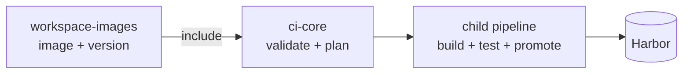
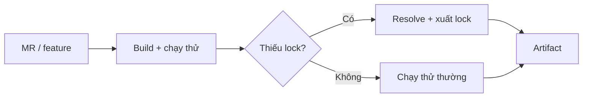
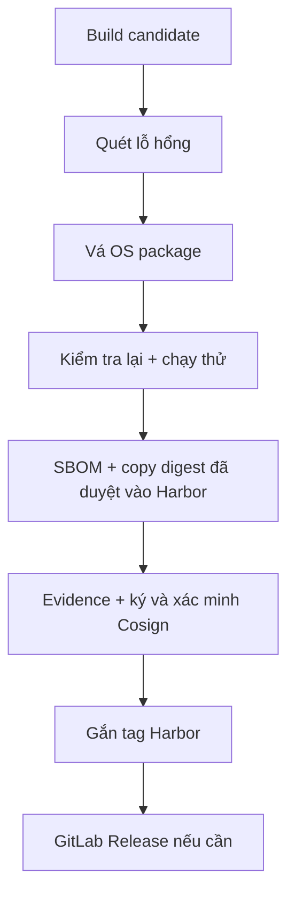
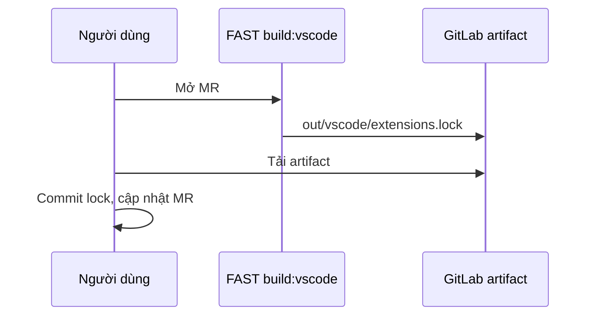

# CI Core

> Bộ máy GitLab CI/CD dùng chung cho các image workspace. Repo này chứa template, script và quy tắc build — **không chứa Dockerfile sản phẩm**.
>
> Repo khai báo image: [`workspace-images`](../workspace-images).

## 1. Hiểu nhanh

- `ci-core` = bộ máy pipeline.
- `workspace-images` = nơi khai báo image (`images.json`, Dockerfile, runtime check).
- Push/MR/tag → consumer gọi core → core validate rồi build.



| Chế độ | Khi nào | Kết quả |
|---|---|---|
| **FAST** | MR hoặc `feature/*` | Build và chạy thử local; không push |
| **FULL** | Protected `main` / release branch | Build, kiểm tra, gắn tag `-dev`/`-rc` |
| **RELEASE** | Protected image tag | Kiểm tra, phát hành tag cố định |

Một số từ dùng trong tài liệu:

- **protected**: nhánh/tag được GitLab bảo vệ, chỉ pipeline đủ quyền mới push/promote.
- **tag**: nhãn version của image trên Harbor.
- **child pipeline**: pipeline con sinh tự động theo từng image; artifact nằm ở đây, không ở parent.

## 2. File quan trọng

### Template (`templates/`)

- `common.yaml` — biến mặc định, job clone `.ci-tools`.
- `workspace-parent.yaml` — kiểm tra source, tạo plan, trigger child pipeline.
- `workspace-child.yaml` — mẫu job cho từng image: build, scan, verify, sign, promote.

### Script (`scripts/`)

- `catalog.py` — đọc `images.json`, chọn image cần build.
- `plan.py` — sinh child pipeline.
- `pipeline.py` — validate, build, smoke test, patch, runtime check.
- `build_gate.py` — build, scan, patch và runtime trong cùng runner; chỉ copy archive đã qua gate.
- `job.py` — quản lý Docker auth trong job.
- `harbor.py` — đọc digest, gắn tag Harbor.
- `release.py` — evidence/provenance, GitLab Release.

Chi tiết từng file: xem mục “Cấu trúc file” trong [`docs/PIPELINE_GUIDE_VI.md`](docs/PIPELINE_GUIDE_VI.md).

## 3. Luồng chạy

### FAST (MR / feature)



FAST không push/sign/promote. Artifact được giữ cả khi job fail.

### FULL / RELEASE



Image gốc và bản vá chỉ tồn tại trên runner. Chỉ archive cuối được copy, kiểm tra digest rồi ký; tag `ci-p…` và tag phát hành trỏ vào cùng digest. Xem [runbook](docs/ROLLOUT_VI.md) cho cấu hình tool image, pilot và retention.

## 4. Cách dùng

### Bước 1: include core

Trong `workspace-images/.gitlab-ci.yml`:

```yaml
include:
  - project: <namespace>/ci-core
    ref: <tag-đã-publish>
    file: /templates/workspace-parent.yaml

variables:
  CI_CORE_PROJECT: "<namespace>/ci-core"
  CI_CORE_REF: "<phải-trùng-ref-ở-include>"
```

`CI_CORE_REF` phải khớp `ref`.

### Bước 2: cấu hình biến

GitLab **Settings → CI/CD → Variables**:

| Biến | Khi nào cần | Nói đơn giản |
|---|---|---|
| `CI_CORE_PROJECT` / `CI_CORE_REF` | Luôn | Trỏ tới core đúng phiên bản. |
| `HARBOR_REGISTRY` / `HARBOR_PROJECT` | Luôn | Nơi push image. |
| `HARBOR_USER` / `HARBOR_PASSWORD` | FULL/RELEASE | Robot push, đặt **Protected**. |
| `COSIGN_PRIVATE_KEY` / `COSIGN_PASSWORD` | Sign/RELEASE | Khóa ký, không đưa vào chat/log. |
| `HTTP_PROXY` / `HTTPS_PROXY` / `NO_PROXY` | Môi trường cần proxy | Chỉ qua biến. |
| `IMAGE_SELECTION` | Run pipeline thủ công | FAST có thể chọn ID; protected `main` chỉ nhận `auto` hoặc `all` (toàn bộ image enabled). |
| `BUILDX_BUILDER_NETWORK` | Thử network khác | Mặc định để trống. |

### Nâng cấp consumer đang chạy

Dùng [mẫu consumer](docs/consumer.gitlab-ci.yml) và [runbook rollout](docs/ROLLOUT_VI.md) sau khi có tag engine đã publish trên GitLab đích. Mẫu giữ rule MR trong consumer; engine tự suy ra mode. Catalog có thể khai báo `"runtime": {"uid": 0, "shell": "/bin/sh", "require_kasm": false}` cho custom image chạy root, hoặc `"uid": 65532` cho image non-root. Engine **không** kiểm tra `USER` trong Dockerfile lúc validate; mọi kiểm tra user/thư mục được thực hiện **sau khi build** qua `runtime_check` trong catalog.

Exception source scan không nằm trong template: khai báo trong `images.json` với `rule_id`, `justification`, `review_by`, `targets`. Engine validate rồi mới sinh ignore file; hết hạn review thì catalog fail.

### Bước 3: chạy theo luồng

1. MR → FAST.
2. Merge protected `main` → FULL.
3. Release branch/tag → RC hoặc production.

## 5. VS Code extension lock

VS Code cần `extensions.lock` là danh sách `ID@version` đã cài thật.

- FULL/RELEASE: lock phải khớp `extensions.txt`, sai thì fail.
- FAST: nếu chưa có lock, pipeline resolve rồi xuất artifact. Người dùng tải về, review, commit qua MR.

Tải artifact: mở **child pipeline** → job `build:vscode` → **Assets / Artifacts** → **Download**. File cần là `out/vscode/extensions.lock`.



## 6. Lỗi thường gặp

| Thấy gì | Thường do | Xử lý |
|---|---|---|
| Lock thiếu/thừa ID | Đang resolve, chưa commit | Tải artifact, commit lock. |
| Pull image DNS timeout | Runner không tới registry | Kiểm tra runner/DinD. |
| Không thấy artifact | Sai pipeline cha/con | Vào child job `build:<image>`. |
| `.ci-tools` lệch template | Ref không khớp include | Sửa `CI_CORE_REF`. |

## 7. Test cục bộ

```bash
cd ci-core
/usr/bin/python3 -m unittest discover -s tests -q
/usr/bin/python3 -m compileall -q scripts tests
/usr/bin/python3 tests/local_integration.py --run   # tuỳ chọn, cần Docker
```

## 8. Nguyên tắc an toàn

- Không log secret hay proxy.
- Không tắt TLS Harbor.
- Không chuyển sang driver `docker` để tránh mất provenance/SBOM.
- Không sửa cấu hình runner từ repo này.

## 9. Đọc thêm

- [`docs/PIPELINE_GUIDE_VI.md`](docs/PIPELINE_GUIDE_VI.md)
- [`CHANGELOG.md`](CHANGELOG.md)
