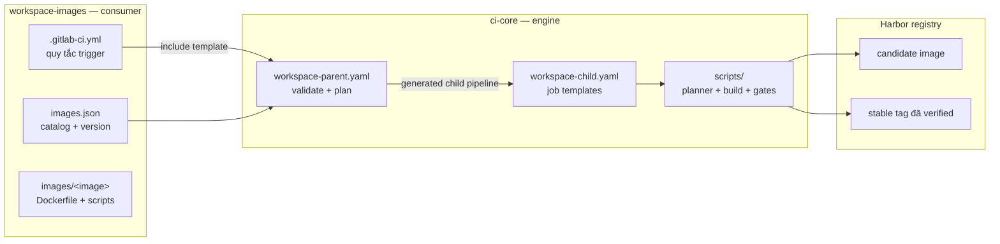
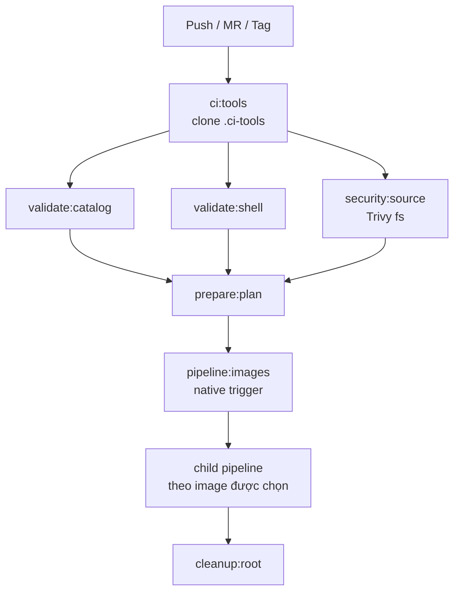
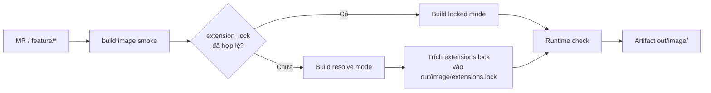
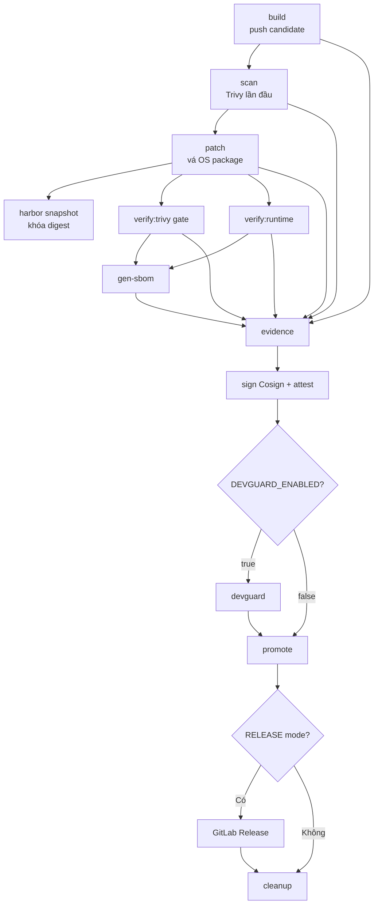
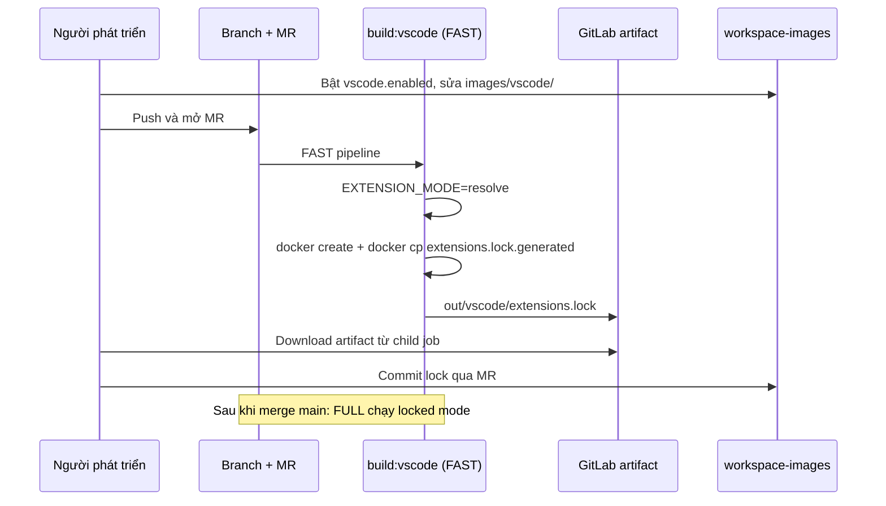

# CI Core

> **Engine cho GitLab CI/CD.** Repo này cung cấp template, script và quy tắc để build image một cách an toàn. Nó **không chứa Dockerfile của sản phẩm**.
>
> Repo cần kết hợp: [`workspace-images`](../workspace-images) — nơi định nghĩa image và version.
>
> Trong tài liệu này, các thuật ngữ lấy từ GitLab/Docker giữ nguyên tiếng Anh. Phần giải thích viết bằng tiếng Việt.

## 1. Nói gọn: `ci-core` làm gì

- Đọc `images.json`, kiểm tra catalog trước khi build.
- Chọn image cần build theo 3 chế độ: **FAST**, **FULL**, **RELEASE**.
- Build bằng Docker Buildx; push candidate image; lưu digest immutable.
- Chạy Trivy scan/gate, runtime check, tạo SBOM, evidence bundle.
- Cosign sign/attest; promote lên Harbor tag ổn định sau khi đã verify.
- Không giữ secret, không hardcode proxy/DNS/registry.

Có ba loại pipeline:

| Loại | Ai trigger | Kết quả |
|---|---|---|
| **FAST** | MR hoặc push lên `feature/*` | Build local + runtime check; **không push** image |
| **FULL** | Push protected `main` hoặc release branch | Build + push candidate + scan/gate + promote `-dev`/`-rc` |
| **RELEASE** | Protected image tag | Build + gate + promote immutable production tag + GitLab Release |

## 2. Hai repo đóng vai trò gì



Trong mỗi job, GitLab clone `.ci-tools/` từ project core tại ref được pin. Vì vậy **`include.ref` và `CI_CORE_REF` phải khớp nhau**. Nếu không, template và script có thể là hai phiên bản khác nhau.

## 3. Cấu trúc file trong `ci-core`

### 3.1 Template GitLab CI (`templates/`)

| File | Nhiệm vụ |
|---|---|
| `common.yaml` | Biến mặc định; job `ci:tools` clone `.ci-tools`; các biến dùng chung. |
| `workspace-parent.yaml` | Parent pipeline: validate source, sinh plan, trigger child pipeline. |
| `workspace-child.yaml` | Job template cho từng image: smoke/build/scan/patch/verify/SBOM/evidence/sign/promote/release/cleanup. |
| `.gitlab-ci.yml` (root) | Test của chính `ci-core`: compile, unit test, `--help` runtime scripts. |

### 3.2 Script vận hành (`scripts/`)

Mọi script runtime **chỉ dùng Python standard library**.

| File | Vai trò |
|---|---|
| `catalog.py` | Đọc và validate `images.json`; chứa logic chọn image (`plan()`). |
| `plan.py` | Sinh `pipeline-plan.json` và `generated-child.yml`. |
| `pipeline.py` | Lệnh `validate`, `smoke`, `build`, `patch`, `runtime`; tạo builder Buildx; trích extension lock. |
| `job.py` | Tạo/xóa Docker auth **riêng theo job**. FAST không nhận credential push/sign. |
| `harbor.py` | Đọc digest từ Harbor; snapshot candidate; promote tag sau verify. |
| `release.py` | Tạo evidence + SLSA predicate + OpenVEX; publish GitLab Release. |

### 3.3 Test (`tests/`)

| File | Kiểm tra |
|---|---|
| `test_pipeline.py` | Planner, tags, FAST/FULL rules, builder option, lock artifact, digest. |
| `test_contracts.py` | Artifact plumbing, `--push`, auth boundary, FAST không sign/promote. |
| `test_security.py` | Redaction, path guard, TLS, release gate. |
| `local_integration.py` | Opt-in fixture end-to-end với Docker/Trivy/Cosign + registry tạm. |

## 4. Luồng pipeline thực tế

### 4.1 Parent pipeline

Parent **không build image**. Nó validate rồi sinh child pipeline.



### 4.2 FAST trên MR hoặc feature branch



FAST luôn `--load` vào Docker local của job. Nó **không push, không sign, không promote**. FAST giữ artifact cả khi job fail để người dùng điều tra.

### 4.3 FULL / RELEASE



Điểm quan trọng:

- Mỗi pipeline build một **candidate tag duy nhất**; không dùng tag mutable để truyền artifact.
- `verified.txt` chứa digest immutable. Scan/gate/runtime/SBOM/sign/promote đều dựa vào digest đó.
- `--provenance=mode=min` và `--sbom=true` được giữ cho build protected.
- Promote chỉ gắn stable tag vào digest đã verified. Release tag không được đổi sang digest khác.

## 5. Khi nào dùng mode nào

| Mode | Trigger | Phạm vi | Push image | Sign + promote |
|---|---|---|---|---|
| `fast` | MR, `feature/*`, `bugfix/*`, `hotfix/*` | Image bị diff ảnh hưởng; hoặc `IMAGE_SELECTION` | Không | Không |
| `full` | Protected `main`; protected release branch | Main: tất cả enabled; release branch: đúng image | Có | Có |
| `release` | Protected image tag | Đúng image; production immutable | Có | Có + GitLab Release |

Tag/branch phải khớp `version` trong `images.json`. Ví dụ version `1.2.0`:

| Ref | Stable tag |
|---|---|
| protected `main` | `1.2.0-dev` |
| protected `release/vscode/v1.2.0` | `1.2.0-rc` |
| protected tag `vscode/v1.2.0` | `1.2.0` |

Nếu nhánh mới không có base diff tin cậy, FAST không tự đoán “all”. Hãy dùng **Run pipeline** với `IMAGE_SELECTION=<image>` khi cần test thủ công.

## 6. Cách cài đặt cho một consumer

Giả sử consumer là `workspace-images`.

### Bước 1 — include parent template

Trong `workspace-images/.gitlab-ci.yml`:

```yaml
include:
  - project: <namespace>/ci-core
    ref: <tag-hoặc-branch>
    file: /templates/workspace-parent.yaml

variables:
  CI_CORE_PROJECT: "<namespace>/ci-core"
  CI_CORE_REF: "<phải-trùng-ref-ở-include>"
```

Ví dụ: nếu `ref: v2.2.0`, thì `CI_CORE_REF: "v2.2.0"`.

### Bước 2 — thêm workflow rules

Workflow rules của consumer quyết định `PIPELINE_KIND`. Copy phần workflow hiện có của `workspace-images/.gitlab-ci.yml`; không tự đặt `PIPELINE_KIND` cứng cho mọi push.

### Bước 3 — thêm CI/CD Variables

Đặt trong GitLab **Settings → CI/CD → Variables**:

| Variable | Bắt buộc | Ý nghĩa |
|---|---:|---|
| `CI_CORE_PROJECT` | Có | Project chứa core. |
| `CI_CORE_REF` | Có | Tag/branch core; khớp `include.ref`. |
| `HARBOR_REGISTRY` | Có | Registry host. |
| `HARBOR_PROJECT` | Có | Project trong Harbor. |
| `HARBOR_USER`, `HARBOR_PASSWORD` | FULL/RELEASE | Robot push + Harbor API. Đặt **Protected**, masked nếu GitLab hỗ trợ. |
| `COSIGN_PRIVATE_KEY`, `COSIGN_PASSWORD` | Sign/RELEASE | File variable hoặc `env://`. Không dán vào chat/log. |
| `HTTP_PROXY`, `HTTPS_PROXY`, `NO_PROXY` | Môi trường cần | Chỉ truyền qua biến; runner daemon/CA do quản trị cấu hình. |
| `BUILDX_BUILDER_NETWORK` | Không | Mặc định rỗng = giữ nguyên hành vi. Giá trị hợp lệ: `host`, `none`, `bridge`, hoặc tên Docker network. |
| `IMAGE_SELECTION` | Không | Override khi Run pipeline; không đặt cố định ở Project Variables. |
| `TRIVY_*`, `AUTO_PATCH_OS`, `PATCH_PACKAGE_EXCLUDE` | Không | Gate/patch policy. |

### Bước 4 — chạy lần đầu

1. Tạo MR trên `workspace-images` → FAST chạy.
2. Merge vào protected `main` → FULL chạy, promote tag `-dev`.
3. Tạo protected release branch → RC.
4. Tạo protected image tag → production immutable.

## 7. VS Code extension lock

VS Code có một bước riêng vì `extensions.lock` phải được tạo bằng cách **cài extension thật trong image**.

### Quy tắc

- `extensions.txt` là danh sách ID extension.
- `extensions.lock` là bảng pin `ID@version`.
- FULL/RELEASE luôn strict: lock thiếu/thừa/sai ID sẽ fail trước khi publish.
- FAST có thể build resolve mode để tạo lock; job **không tự commit** lock vào repo.

### Quy trình tạo lock lần đầu



Cách tải artifact:

1. Vào **pipeline con** (child), không phải pipeline cha.
2. Vào job `build:vscode`.
3. Ở khối **Assets / Artifacts**, bấm **Download** để tải `.zip`.
4. Giải nén, lấy `out/vscode/extensions.lock`.
5. Review rồi commit vào `images/vscode/configs/extensions.lock`.
6. Cập nhật MR. Khi merge vào `main`, FULL build sẽ chạy locked mode.

Nếu job failed sau khi đã upload artifact, vẫn thử tab Assets của job đó.

## 8. Test cục bộ

Không cần GitLab, Harbor hay runner:

```bash
cd ci-core
/usr/bin/python3 -m unittest discover -s tests -q
/usr/bin/python3 -m compileall -q scripts tests
```

Kiểm tra YAML cần PyYAML. Trên máy này dùng `/usr/bin/python3`:

```bash
/usr/bin/python3 - <<'PY'
import pathlib, yaml
for p in list(pathlib.Path('templates').glob('*.yaml')) + [pathlib.Path('.gitlab-ci.yml')]:
    yaml.safe_load(p.read_text())
    print('YAML OK', p)
PY
glab ci lint --dry-run --ref main
git diff --check
```

Integration fixture opt-in:

```bash
/usr/bin/python3 tests/local_integration.py          # chỉ in plan
/usr/bin/python3 tests/local_integration.py --run    # Docker/Trivy/Cosign thật, registry tạm
```

Test local **không thay thế** GitLab runner thật, Harbor API, VS Code Marketplace hay UAT GUI.

## 9. Ràng buộc an toàn

- Không log credential hay proxy value; lệnh in ra phải redact `--driver-opt`.
- Không tắt TLS Harbor; cài CA tin cậy thay vì bypass.
- Không chuyển sang driver `docker` để tránh lỗi provenance/SBOM.
- Không sửa `/etc/docker/daemon.json` hay cấu hình runner từ repo này.
- Không đặt secret vào `.gitlab-ci.yml`, Dockerfile hay build args không cần thiết.
- Consumer cần quyền đọc `ci-core` để include và clone `.ci-tools`.

## 10. Đọc thêm

- Bảng nhiệm vụ file: mục 3.
- Chi tiết vận hành: [`docs/PIPELINE_GUIDE_VI.md`](docs/PIPELINE_GUIDE_VI.md)
- Thay đổi gần nhất: [`CHANGELOG.md`](CHANGELOG.md)
