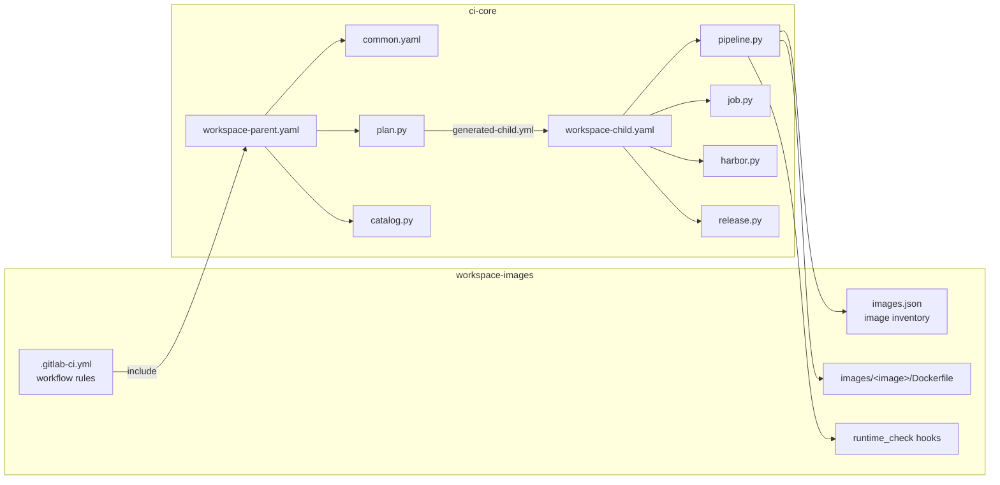
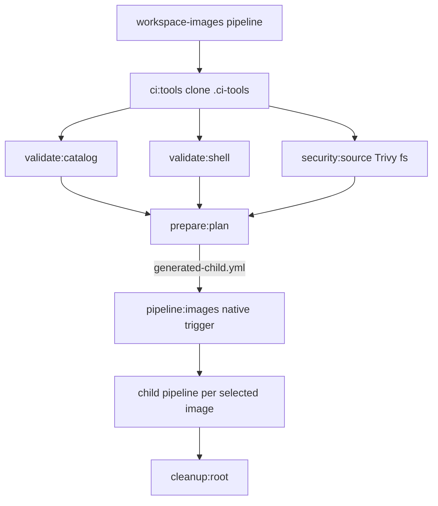
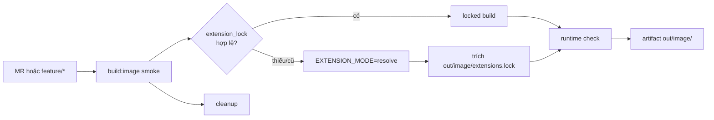
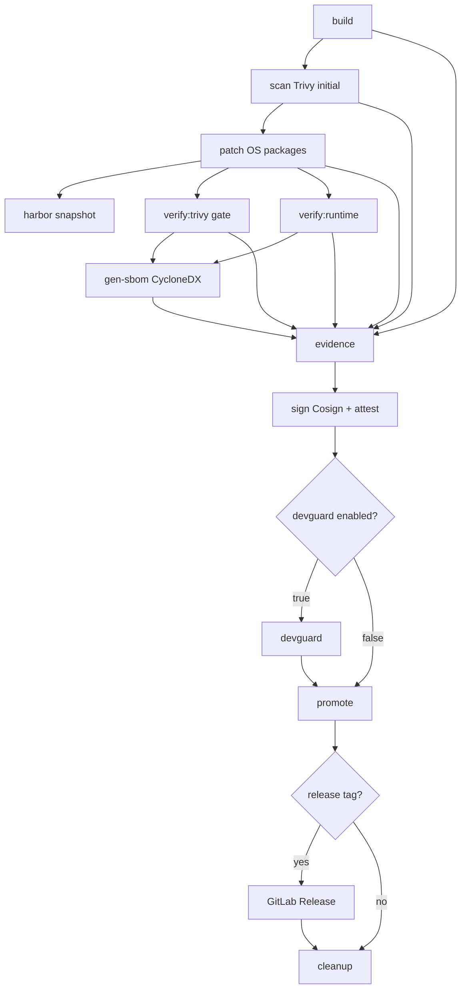
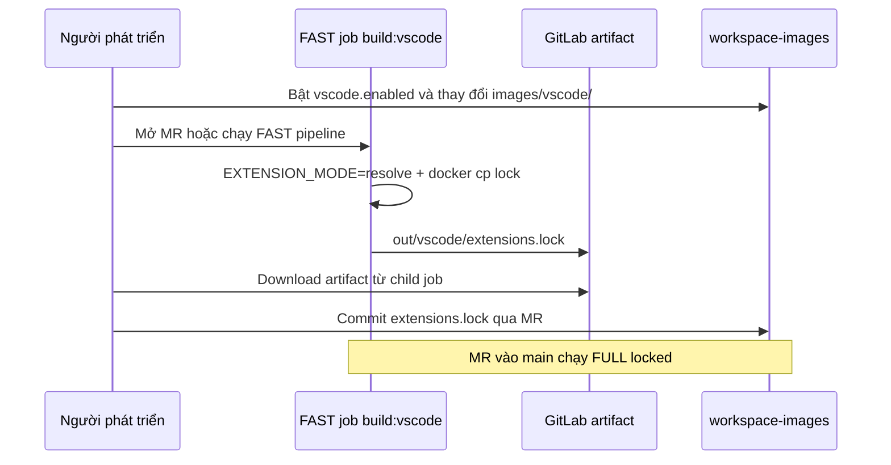

# CI Core

> GitLab CI/CD engine dùng chung cho `workspace-images`. Thuật ngữ chuyên ngành được giữ tiếng Anh; phần mô tả và hướng dẫn viết bằng tiếng Việt.

## 1. repo này làm gì

`ci-core` **không chứa Dockerfile của sản phẩm**. Repo này cung cấp hạ tầng pipeline:

- **Catalog validation**: kiểm tra `images.json`, Dockerfile, shell script và metadata trước khi build.
- **Planner**: chọn image cần build theo FAST / FULL / RELEASE và sinh child pipeline.
- **Build runtime**: Buildx, registry cache, immutable digest, provenance, SBOM.
- **Quality gates**: Trivy scan/gate, runtime check, evidence bundle, Cosign signing.
- **Promotion**: gắn tag Harbor chỉ sau khi artifact đã verified và signed.
- **Tests**: unit, contract, security và local integration harness.

`workspace-images` là **consumer**: chứa `images.json`, Dockerfile từng image, runtime hook và `.gitlab-ci.yml` include template từ `ci-core`.



Trong mỗi job, GitLab clone `.ci-tools/` từ `CI_CORE_PROJECT` tại đúng `CI_CORE_REF`. Vì vậy **`include.ref` và `CI_CORE_REF` phải giống nhau**, nếu không template và script sẽ lệch phiên bản.

## 2. Cấu trúc file và nhiệm vụ

### 2.1 Templates (`templates/`)

| File | Nhiệm vụ |
|---|---|
| `common.yaml` | Biến mặc định, image tham chiếu, job `ci:tools` clone `.ci-tools`. |
| `workspace-parent.yaml` | Parent pipeline: validate catalog/shell/source, tạo plan, trigger child pipeline, cleanup. |
| `workspace-child.yaml` | Hidden template per-image: smoke/build/scan/patch/verify/sbom/evidence/sign/devguard/promote/release/cleanup. |
| `.gitlab-ci.yml` (repo root) | Pipeline test của chính `ci-core`: compile, unit tests và `--help` của runtime scripts. |

### 2.2 Scripts (`scripts/`)

Runtime script **chỉ dùng Python standard library**; không cần dependency mới.

| File | Command | Nhiệm vụ |
|---|---|---|
| `catalog.py` | import | Đọc `images.json`; validate schema, ID, version, Dockerfile, shared deps, extension lock, runtime_check; chứa `plan()`. |
| `plan.py` | `plan.py --output generated-child.yml` | Ghi `pipeline-plan.json` và sinh child YAML hợp lệ. Không dùng PyYAML ở runtime. |
| `pipeline.py` | `validate` | Validate catalog theo `PIPELINE_KIND`. FAST nới lock completeness; FULL/RELEASE strict. |
| | `smoke` | FAST build local, không push. VS Code lock chưa hợp lệ → resolve mode + trích `out/<image>/extensions.lock`. |
| | `build` | Build push candidate tag; yêu cầu protected ref; ghi digest immutable từ `build-metadata.json`. |
| | `patch` | Áp OS package fixes có bản vá, rebuild từ digest đã build. |
| | `runtime` | Runtime gate trên immutable digest. |
| `job.py` | `docker-auth`, `cleanup-auth` | Tạo/xóa Docker auth **job-scoped**. FAST không nhận credential push/sign. |
| `harbor.py` | `snapshot` | Đọc lại candidate digest từ Harbor; từ chối nếu digest đã đổi sau patch. |
| | `promote` | Kiểm tra evidence/runtime/Cosign/SBOM rồi mới gắn stable tag. |
| `release.py` | `evidence` | Tổng hợp `evidence.json`, SLSA predicate, OpenVEX (nếu có), summary. |
| | `publish` | Tạo/verify GitLab Release chỉ cho protected image tag. |

### 2.3 Tests (`tests/`)

| File | Phạm vi |
|---|---|
| `test_pipeline.py` | Planning, tags, FAST/FULL rules, builder option, artifact/lock flow, digest policy. |
| `test_contracts.py` | Artifact plumbing, `--push` flags, auth boundary, không sign/promote trên FAST/MR. |
| `test_security.py` | Secret redaction, PATH/traversal guard, TLS verify, trusted release gates. |
| `local_integration.py` | Opt-in fixture end-to-end với Docker/Trivy/Cosign/registry tạm. Không tác động Harbor production. |
| `requirements.txt` | Chỉ PyYAML cho test/lint cục bộ. |

## 3. Luồng pipeline

### 3.1 Parent → dynamic child



Parent **không build image**. Trigger job không có image/script/services; nó chỉ chuyển child YAML qua GitLab.

### 3.2 FAST / MR



FAST luôn `--load`, **không push, không sign, không promote**. Artifact được giữ kể cả khi job fail để điều tra.

### 3.3 FULL / RELEASE DAG



Nguyên tắc bắt buộc:

- Candidate tag duy nhất theo parent pipeline + commit; không truyền artifact bằng tag mutable.
- Scan/gate/runtime/SBOM/sign/promote dựa trên **immutable digest** trong `verified.txt`.
- Protected build giữ `--provenance=mode=min` và `--sbom=true`.
- Promote chỉ gắn tag đã verified; release tag không ghi đè digest khác.

## 4. Pipeline modes

| Mode | Khi nào | Phạm vi | Push | Sign/Promote |
|---|---|---|---|---|
| `fast` | MR, `feature/*`, `bugfix/*`, `hotfix/*`, web run | Image bị diff ảnh hưởng hoặc `IMAGE_SELECTION` | Không | Không |
| `full` | Protected `main`; protected `release/<image>/vX.Y.Z` | Main: tất cả enabled; release branch: đúng image | Có | Có |
| `release` | Protected tag `<image>/vX.Y.Z` hoặc `release/<image>/vX.Y.Z` | Đúng image, immutable tag `X.Y.Z` | Có | Có + GitLab Release |

FAST không đoán “all” khi base diff không tin cậy. Muốn test thật trên nhánh mới, dùng **Run pipeline** với `IMAGE_SELECTION=<image>`.

## 5. Bắt đầu sử dụng

### 5.1 Consumer include core

Trong `workspace-images/.gitlab-ci.yml`:

```yaml
include:
  - project: <namespace>/ci-core
    ref: <tag-hoặc-branch>
    file: /templates/workspace-parent.yaml

variables:
  CI_CORE_PROJECT: "<namespace>/ci-core"
  CI_CORE_REF: "<đúng-ref-ở-include>"
```

`include.project` và `CI_CORE_PROJECT` phải trỏ cùng project; `include.ref` và `CI_CORE_REF` phải khớp.

### 5.2 Variables môi trường

Đặt trong GitLab **CI/CD Variables**, least privilege. Không hardcode trong source.

| Variable | Bắt buộc | Ý nghĩa |
|---|---:|---|
| `CI_CORE_PROJECT` | Có | Project chứa template/script core. |
| `CI_CORE_REF` | Có | Tag/branch core; khớp include. |
| `HARBOR_REGISTRY` | Có | Registry host. |
| `HARBOR_PROJECT` | Có | Project trong Harbor. |
| `HARBOR_USER`, `HARBOR_PASSWORD` | Protected/release | Robot push + Harbor API. Protected/masked. |
| `COSIGN_PRIVATE_KEY`, `COSIGN_PASSWORD` | Release/sign | File variable hoặc `env://` key. Không đưa vào chat/log. |
| `HTTP_PROXY`, `HTTPS_PROXY`, `NO_PROXY` | Môi trường cần proxy | Chỉ truyền qua biến; daemon/CA của runner do quản trị cấu hình. |
| `BUILDX_BUILDER_NETWORK` | Không | Mặc định rỗng = giữ hành vi hiện tại. Nếu đặt: `host`, `none`, `bridge` hoặc tên Docker network hợp lệ. |
| `IMAGE_SELECTION` | Không | Override khi Run pipeline; không đặt cố định ở Project Variables. |
| `TRIVY_*`, `AUTO_PATCH_OS`, `PATCH_PACKAGE_EXCLUDE` | Không | Gate/patch policy. |

### 5.3 Tag policy

Version đến từ `images.json` của từng image:

- protected `main` → `{version}-dev`
- protected `release/<image>/v{version}` → `{version}-rc`
- protected image tag → `{version}` (immutable)

Candidate tag tạm thời: `ci-p<parent-pipeline>-<commit>`. Mọi gate theo digest, không theo candidate tag.

## 6. VS Code extension lock

`images/vscode/configs/extensions.txt` là manifest ID; `images/vscode/configs/extensions.lock` là pin phiên bản.

- FULL/RELEASE luôn strict: thiếu/sai format/trùng/thừa ID → fail trước khi publish.
- FAST trên development branch: lock chưa hợp lệ → build resolve mode, trích artifact, chạy runtime check resolve mode. Job **không tự commit**.



Tải artifact từ **child job** `build:vscode`, không lấy từ parent. Job failed sau khi upload artifact vẫn có thể xem tab Assets/Artifacts.

## 7. Test cục bộ

Không cần GitLab/Harbor:

```bash
cd ci-core
/usr/bin/python3 -m unittest discover -s tests -q
/usr/bin/python3 -m compileall -q scripts tests
/usr/bin/python3 - <<'PY'
import pathlib, yaml
for p in list(pathlib.Path('templates').glob('*.yaml')) + [pathlib.Path('.gitlab-ci.yml')]:
    yaml.safe_load(p.read_text())
    print('YAML OK', p)
PY
glab ci lint --dry-run --ref main
git diff --check
```

Integration fixture opt-in:

```bash
/usr/bin/python3 tests/local_integration.py          # chỉ in plan
/usr/bin/python3 tests/local_integration.py --run    # Docker/Trivy/Cosign thật, registry tạm
```

Test cục bộ **không thay thế** GitLab runner thật, Harbor API, marketplace hay UAT GUI.

## 8. Ràng buộc an toàn

- Không log credential/proxy value; `--driver-opt` phải được redact khi in lệnh.
- Không tắt TLS Harbor để promote; cài CA tin cậy.
- Không fallback sang driver `docker` để tránh lỗi provenance/SBOM.
- Không sửa `/etc/docker/daemon.json` hay cấu hình runner từ repo này.
- Không đặt secret vào `.gitlab-ci.yml`, Dockerfile hay build args không cần thiết.
- Consumer phải được phép đọc `ci-core` bằng job token/include permission.

## 9. Tham khảo

- Hướng dẫn vận hành chi tiết: [`docs/PIPELINE_GUIDE_VI.md`](docs/PIPELINE_GUIDE_VI.md)
- Lịch sử thay đổi: [`CHANGELOG.md`](CHANGELOG.md)
- Inventory consumer: repo `workspace-images`, file `images.json`
